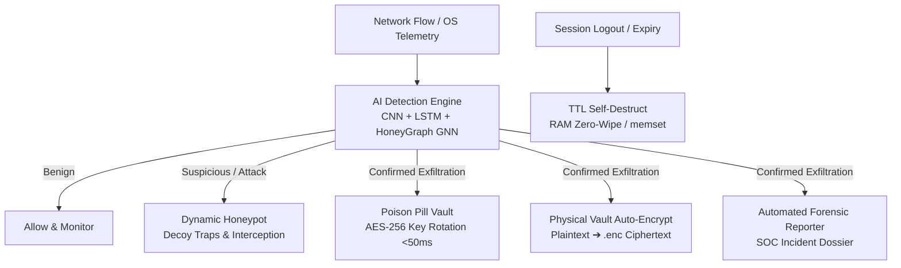

# =============================================================================
# SHADOWMIND — AN ADAPTIVE CYBER DEFENSE SYSTEM
# =============================================================================

[](#overview)
[](#tech-stack)
[](#license)

ShadowMind is an enterprise-grade, zero-trust cybersecurity defense system designed to defeat **low-and-slow data exfiltration** and multi-hop lateral movement attacks. It unifies deep learning detection, graph topology analysis, AES-256 cryptographic vault protection, dynamic deception honeypots, and automated forensic reporting into a standalone Windows executable (`ShadowMind.exe`).

---

## Table of Contents

- [Overview](#overview)
- [System Architecture](#system-architecture)
- [Key Features & Pillars](#key-features--pillars)
- [Technology Stack](#technology-stack)
- [Project Structure](#project-structure)
- [Installation & Quick Start](#installation--quick-start)
- [Running the Application](#running-the-application)
- [Live Attack Demonstration Guide](#live-attack-demonstration-guide)
- [Testing](#testing)
- [License](#license)

---

## Overview

Traditional security tools act as static perimeters—blocking attackers at the door but leaving files and keys vulnerable once an adversary slips inside over months of low-and-slow beaconing. 

**ShadowMind** inverts this model into a **self-healing, zero-trust immune system**:
1. **Detects** anomalous spatial, temporal, and graph-topology indicators in real time.
2. **Defends** by instantly auto-encrypting local working folders and rotating AES-256 session keys in RAM in under 50 milliseconds.
3. **Deceives** attackers by redirecting them into a dynamic honeypot sandbox and compiling court-ready forensic incident reports.

---

## System Architecture



---

## Key Features & Pillars

1. **AI Detection Engine:** 3-way neural network ensemble (Spatial 1D CNN, Temporal LSTM, and PyTorch Geometric HoneyGraph GNN) achieving **99.96% accuracy** on CICIDS2017 flow data.
2. **Physical Local Storage Vault (`/Vault` folder):** Automatically creates a physical folder on startup where users work normally in plaintext; instantly auto-encrypts files into `.enc` ciphertext upon breach detection.
3. **Poison Pill Vault:** AES-256 Fernet encryption with keys held exclusively in RAM. Executes emergency re-encryption in < 50ms, rendering stolen ciphertext permanently invalid.
4. **Dynamic Honeypot & Threat Intelligence:** Deploys interactive decoy shares (`aws_production_keys.env`, `financial_passwords.xlsx`), logs attacker IP addresses, and profiles infrastructure via geolocation/ASN lookup.
5. **TTL Self-Destruct:** Forcefully zero-wipes decryption keys from RAM (`memset`) upon session expiry or exit.
6. **Automated Forensic Reporting:** Autonomously compiles timestamped SOC incident reports (`Incident_Report_<timestamp>.txt`) upon confirmed intrusion.

---

## Technology Stack

- **Core Runtime:** Python 3.10+ / PyInstaller (`ShadowMind.exe`)
- **AI / ML:** PyTorch, PyTorch Geometric (GNN), scikit-learn, NumPy, Pandas
- **Cryptography:** `cryptography` library (AES-256 Fernet CBC + HMAC-SHA256)
- **Desktop UI:** CustomTkinter (OLED dark cyberpunk glassmorphism)
- **Network / Telemetry:** Built-in TCP Socket & HTTP Gateway (Port 8080), Cloudflare Tunnels (`cloudflared`)

---

## Project Structure

```
Shadowmind/
├── configs/
│   ├── thresholds.yaml          # Tunable system thresholds & TTL params
│   └── thresholds_tuned.yaml    # Production-optimized config
├── data/
│   ├── honeypot/                # Deployed decoy trap files
│   ├── reports/                 # Auto-generated SOC forensic reports
│   └── vault/                   # Static encrypted vault storage
├── docs/                        # Phase completion reports & test documentation
├── models/
│   └── detection/               # Trained model weights (cnn.pt, lstm.pt, gnn.pt, mlp.pt)
├── src/
│   ├── auth/                    # Secure authentication & password hashing
│   ├── data/                    # Synthetic generator, preprocessor, graph builder
│   ├── detection/               # CNN, LSTM, GNN, MLP fusion, training script
│   ├── honeypot/                # Decoy manager, interaction logger, redirector
│   ├── intelligence/            # AttackerProfiler & IncidentReporter
│   ├── utils/                   # Path helpers & global settings state
│   ├── vault/                   # AES vault, keygen, rotation, TTL zero-wipe
│   └── workspace/               # External physical Vault folder manager
├── ui/
│   ├── tabs/                    # Dashboard, File Vault, Honeypot, Settings tabs
│   ├── widgets/                 # Interactive card-based log viewer
│   ├── animations.py            # Button hover micro-interactions
│   ├── main_window.py           # Main application shell & login terminal
│   └── theme.py                 # OLED dark mode design tokens
├── website/                     # Vercel cyberpunk landing page
├── tests/
│   └── test_integration.py      # End-to-end attack simulation test suite
├── main.py                      # Application entry point
├── proxy.py                     # Multi-hop proxy relay for mobile/Termux
├── wsl_redteam_exploit.py       # Red-team kill-chain attack simulation tool
└── requirements.txt             # Python dependencies
```

---

## Prerequisites

- Python 3.10 or higher
- Windows 10/11 (for desktop application and physical `/Vault` folder integration)

---

## Installation and Setup

### Option A: Using the Standalone Executable (Recommended for Demo)
1. Download **`ShadowMind.exe`** from the [GitHub Releases Page](https://github.com/Sourya-Dey05/Shadowmind/releases/tag/v1.0.0).
2. Double-click `ShadowMind.exe` directly. No Python installation, virtual environment, or `pip install` required!

### Option B: Running from Source Code (For Developers)
1. **Clone the Repository:**
   ```bash
   git clone https://github.com/Sourya-Dey05/Shadowmind.git
   cd Shadowmind
   ```

2. **Create & Activate Virtual Environment:**
   ```powershell
   python -m venv .venv
   .venv\Scripts\activate
   ```

3. **Install Dependencies:**
   ```powershell
   pip install -r requirements.txt
   pip install torch
   ```

---

## Running the Application

### 1. Launching the Software
- **If running from source:**
  ```powershell
  python main.py
  ```
- **If running the standalone binary:** Double-click `ShadowMind.exe`.

### 2. Operator Authentication
When the login terminal appears, sign in with your administrator credentials:
- **Operator Email:** `souryanew@shadowmind.com`
- **Password:** `Sourya@2026dey`

### 3. Navigating the Command Center
Once authenticated, you have access to four primary control tabs:
- **Dashboard:** Real-time AI threat scoring (Spatial CNN + Temporal LSTM + HoneyGraph GNN), live threat metrics, and interactive event logs.
- **File Vault & Workspace:** Monitors the physical local `/Vault` folder (`D:\Shadowmind\Vault`) where plaintext files are auto-encrypted into `.enc` ciphertext upon attack detection. Includes decryption tools and emergency key rotation (`ROTATE KEY NOW`).
- **Honeypot:** Displays active deployed deception traps and live attacker interception intel feeds.
- **Settings:** Configures detection filtering modes ("Attack Only" vs. "Attack & Benign") and reviews exfiltration breach audit history.

---

## Live Attack Demonstration Guide

### Testing Local / Cross-Device Ingress:
1. Ensure ShadowMind is running (`python main.py`).
2. Expose port 8080 using Cloudflare Tunnel:
   ```powershell
   .\cloudflared.exe tunnel --url http://localhost:8080
   ```
3. Visit the public `https://...trycloudflare.com` URL from your mobile phone (on cellular data).
4. **Observed Defense:**
   - Dashboard turns **Red (`CONFIRMED EXFILTRATION`)**.
   - Physical `/Vault` folder (`D:\Shadowmind\Vault`) auto-encrypts files into `.enc` ciphertext in ~18ms.
   - Honeypot tab records the attacker IP, geolocation, and file download attempts.
   - Forensic report generated automatically in `data/reports/`.

---

## Testing

Run the automated end-to-end integration test suite:
```powershell
$env:PYTHONPATH="D:\Shadowmind"
python tests/test_integration.py
```

---

## License

Distributed under the MIT License. See `LICENSE` for more information.

---
*Developed as part of Group GRP-45.*
